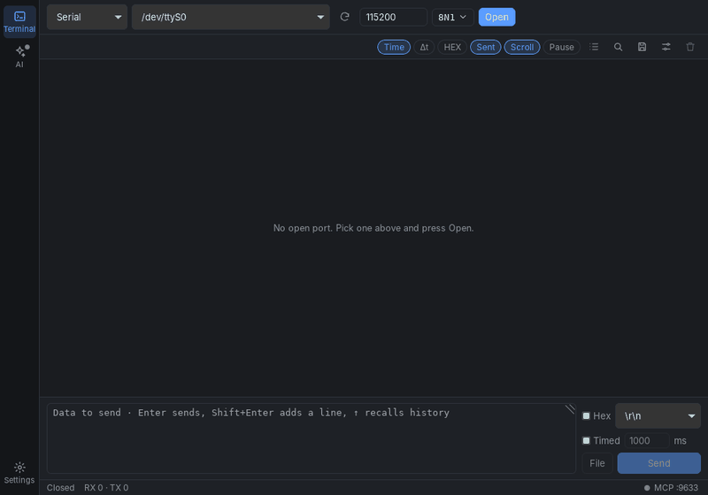
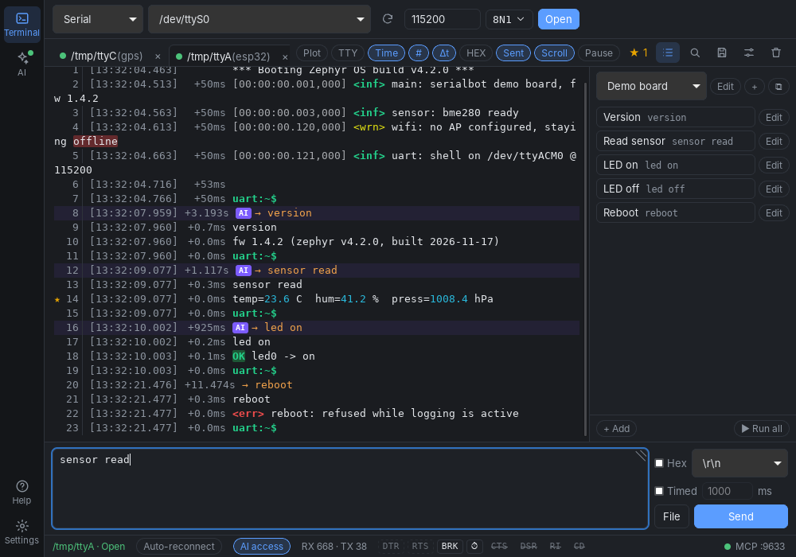
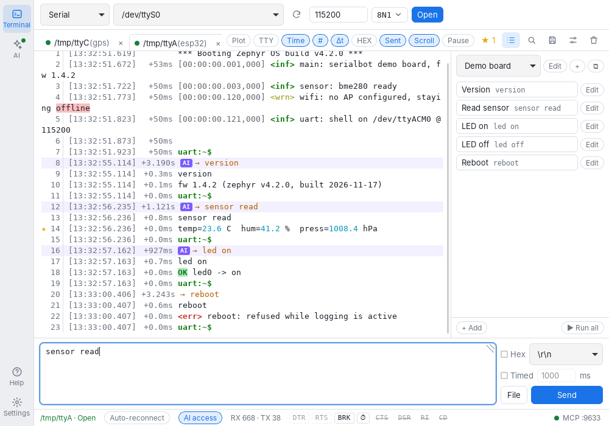
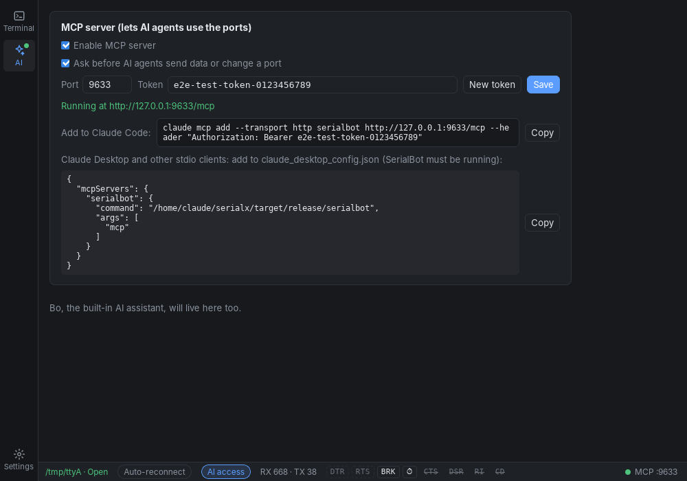

<div align="center">


# SerialBot

**轻量、跨平台的串口调试助手，内置 MCP 服务，让 AI 也能直接操作串口** 🔌🤖

[](https://github.com/SerialAI/SerialBot/actions/workflows/ci.yml)
[](https://github.com/SerialAI/SerialBot/releases)

[](LICENSE)

简体中文 · [English](README.en.md)



<sub>☝️ Claude Code 通过 MCP 打开开发板串口、发命令、等回复，窗口实时显示每一步</sub>

</div>

> [!NOTE]
> 🚧 **当前是 Alpha 测试版**：基础功能可用，欢迎试用并[反馈问题](https://github.com/SerialAI/SerialBot/issues)。

## ✨ 特性

- 🪶 **轻量**：Windows 安装包约 3.5 MB，还有免安装单文件版。
- 💻 **跨平台**：Windows、macOS（Apple Silicon 和 Intel）、Linux 都能用。
- 🗂️ **多串口同时打开**：每个串口一个标签页，各自有日志和收发计数。
- 🌈 **接收显示**：
  - 文本 / HEX 两种显示方式，带毫秒级时间戳
  - 支持 **ANSI 颜色**（Zephyr、ESP-IDF 等彩色日志）
  - 支持 GBK、GB18030、Big5 等多种编码
  - 自动断帧、暂停、`Ctrl/Cmd+F` 搜索
  - 几万行日志依然流畅
- ✍️ **发送**：多行输入，文本或 HEX，可选结尾符；`Enter` 发送，`Shift+Enter` 换行，`↑` 调出历史；支持定时发送。
- 🎛️ **信号线**：DTR / RTS 开关，CTS / DSR / RI / CD 指示灯，每次切换都会在日志里记一笔。
- 🤖 **AI 友好**：内置 MCP 服务，Claude Code 等 AI 工具可以直接
  - 列出、打开串口
  - 收发数据、等待匹配的回复
  - 控制 DTR / RTS

  你在窗口里打开的串口，AI 能接着用；AI 发的每条数据，窗口里也看得到。

## 📸 截图

| 深色主题 | 浅色主题 |
|:---:|:---:|
|  |  |

<details>
<summary>🤖 AI 页：MCP 服务设置</summary>



</details>

## 📦 下载安装

到 [Releases 页面](https://github.com/SerialAI/SerialBot/releases) 下载对应系统的文件：

| 系统 | 文件 | 说明 |
|---|---|---|
| 🪟 Windows 10/11 | `SerialBot_*_x64-setup.exe` | 安装版，不需要管理员权限 |
| 🪟 Windows 10/11 | `serialbot_windows_x64.exe` | 免安装版，双击直接运行 |
| 🍎 macOS 11+ | `SerialBot_*_universal.dmg` | Apple Silicon 和 Intel 通用 |
| 🐧 Ubuntu / Debian | `SerialBot_*_amd64.deb` | `sudo apt install ./SerialBot_*.deb` |
| 🐧 其他 Linux | `SerialBot_*_amd64.AppImage` | `chmod +x` 后直接运行 |

<details>
<summary>⚠️ 首次打开遇到提示？</summary>

- **macOS 提示「已损坏」或「无法打开」**：Alpha 版还没做苹果公证，在终端执行一次：
  ```sh
  xattr -dr com.apple.quarantine /Applications/SerialBot.app
  ```
- **Windows 提示「未知发布者」**：点「更多信息」→「仍要运行」。
- **Linux 打不开串口（权限不够）**：执行下面这条，然后重新登录：
  ```sh
  sudo usermod -aG dialout $USER
  ```

</details>

## 🚀 快速上手

1. 🔌 插上 USB 转串口模块，在顶部选择端口，设置波特率。数据位、校验、停止位、流控在 `8N1 ▾` 里，然后点 **打开**。
2. 📥 接收区默认显示时间戳。右上角的小开关可以切换 HEX 显示、显示发送内容、自动滚动、暂停；🔍 是搜索，⚙️ 里可以设置编码、自动断帧和 ANSI 颜色。
3. 📤 在底部输入框写好命令，按 `Enter` 发送。勾选 HEX 可以发送 `01 03 00 00` 这样的十六进制数据。
4. 🎛️ 需要复位开发板时，点状态栏的 **DTR / RTS**。

> [!TIP]
> 如果开发板没有接 CTS 线，流控请保持「无」。开着 RTS/CTS 硬件流控时，数据会因为 CTS 无效而发不出去。

## 🤖 让 AI 操作串口（MCP）

1. 点左侧 **AI** → 勾选 **启用 MCP 服务**。服务只监听本机 `127.0.0.1`，访问需要 token。
2. 点 **复制**，在终端里运行复制下来的命令，例如：
   ```sh
   claude mcp add --transport http serialbot http://127.0.0.1:9633/mcp \
     --header "Authorization: Bearer <你的 token>"
   ```
3. 在 Claude Code 里直接说：*「列出串口，打开 ESP32 那个口，发送 `version` 看看固件版本」* 🎉

| 工具 | 作用 |
|---|---|
| `port.list` / `session.list` | 列出串口 / 已打开的会话 |
| `session.open` | 打开串口（可以起个别名，比如 `esp32`） |
| `io.write` / `io.read` | 发送数据 / 按游标读取带时间戳的日志 |
| `io.wait_for` | 等待接收内容匹配某个正则表达式 |
| `io.send_and_expect` | 发送一条命令并等待期望的回复 |
| `io.signals` | 设置 DTR / RTS，读取 CTS / DSR / RI / CD |

## 🗺️ 路线图

- [x] 串口收发、多会话、时间戳、HEX
- [x] ANSI 颜色、多编码、自动断帧、搜索、大日志流畅显示
- [x] DTR / RTS 和信号状态
- [x] 内置 MCP 服务
- [x] 三平台安装包自动发布
- [x] 定时发送、发送历史
- [ ] 发送文件
- [ ] 扩展命令列表（分组、一键顺序发送）
- [ ] 接收存文件、导出
- [ ] 热插拔检测、自动重连
- [ ] TCP Client / Server、UDP
- [ ] 内置 AI 助手「小波」

## 🛠️ 从源码构建

需要 Rust（版本由 `rust-toolchain.toml` 自动安装）和 Node 22+。Linux 还要装几个系统库：

```sh
sudo apt install libwebkit2gtk-4.1-dev librsvg2-dev libayatana-appindicator3-dev libudev-dev
```

```sh
cd app && npm ci && npm run tauri dev     # 运行桌面版
cargo test --workspace                    # Rust 测试
cd app && npm test                        # 前端测试
cargo run -p serialbot-mcp                  # 不带界面，单独运行 MCP 服务
```

每次改动都要附带测试，并通过格式、clippy、测试和覆盖率检查，详见 [CLAUDE.md](CLAUDE.md)。

## 🤝 反馈

发现 bug 或有功能建议，欢迎提 [Issue](https://github.com/SerialAI/SerialBot/issues)。请附上：

- 📷 截图
- 💻 操作系统
- 🔌 串口芯片型号（CH340 / CP2102 / FT232 / CH9344 …）

## 📄 许可证

核心代码使用 [GPL-3.0-only](LICENSE)。插件 SDK 和设备端库将使用 MIT 许可。
