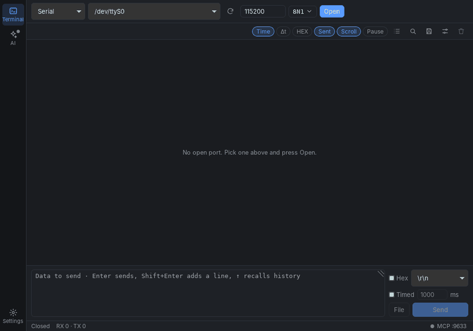
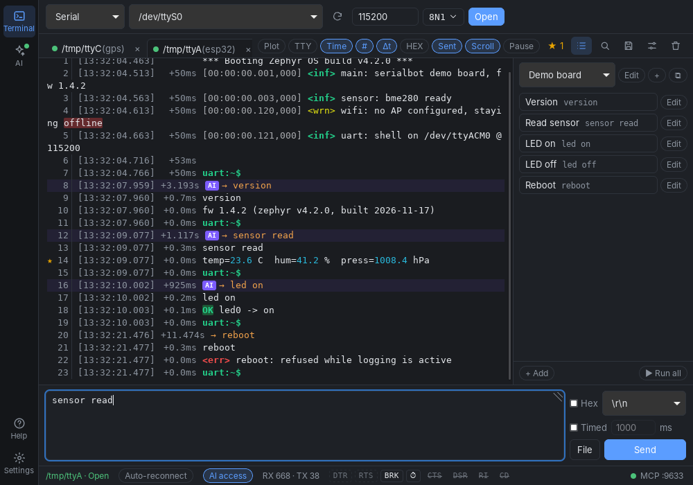
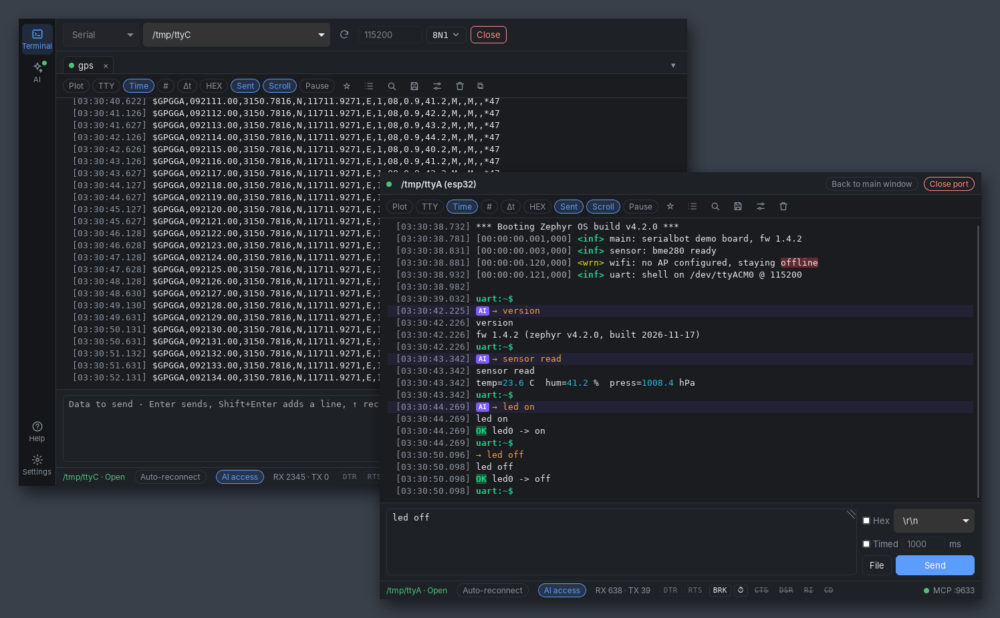
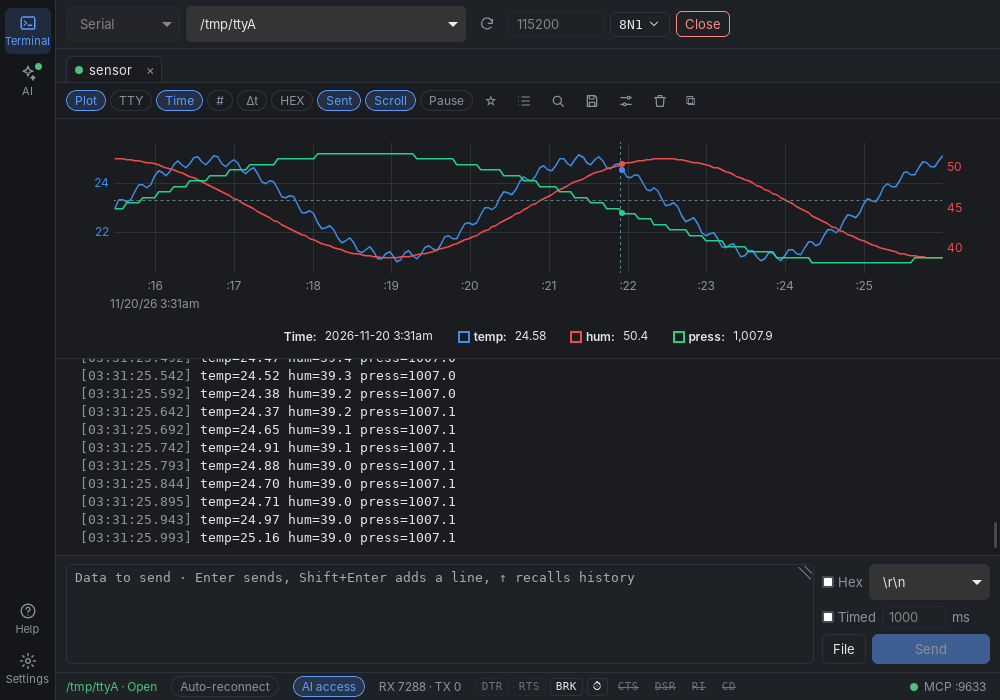
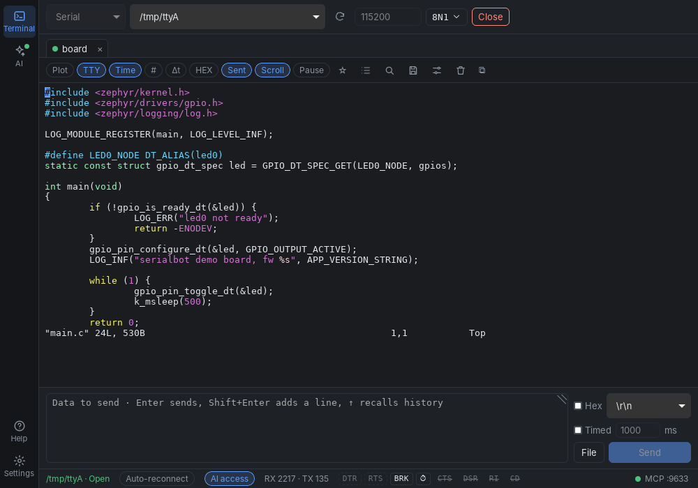
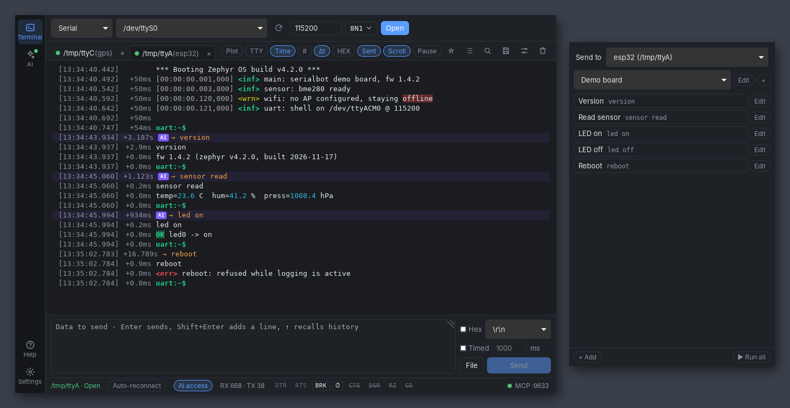
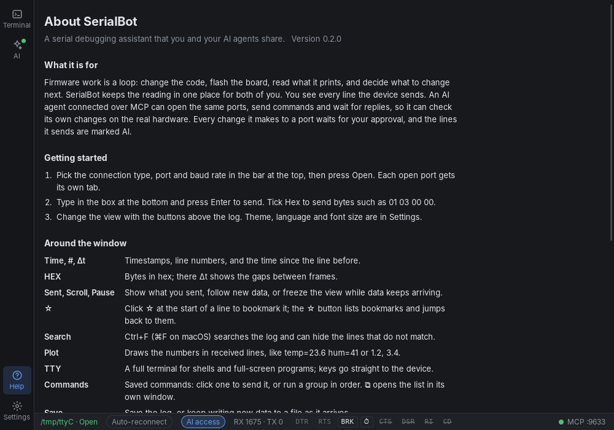

<div align="center">


# SerialBot

**嵌入式硬件的验证闭环：轻量、跨平台的串口调试助手，内置 MCP 服务，让 AI 在真实的板子上自己烧录、看日志、验证结果** 🔌🤖

[](https://github.com/jerry-token/serialbot/actions/workflows/ci.yml)
[](https://github.com/jerry-token/serialbot/releases)

[](LICENSE)

[English](README.md) · 简体中文 · 🌐 [serialbot.aiany.cc](https://serialbot.aiany.cc/zh/)



<sub>☝️ AI 通过 MCP 打开开发板串口并发送命令，你确认后执行，每一步都实时显示在窗口里，并带 AI 标记</sub>

</div>

> [!NOTE]
> 🧪 **当前是 Beta 测试版**：首个正式版计划的功能已经齐全，真机验证正在进行。欢迎试用并[反馈问题](https://github.com/jerry-token/serialbot/issues)。

## 💡 为什么做 SerialBot

**SerialBot 是嵌入式硬件验证闭环中的关键一环。**

编码 Agent 靠自己验证结果赢得信任。把 Agent 用得最好的团队，都把验证当作工作的核心：打造 Grok Bot 的 [Lauren Tan（@poteto）](https://x.com/poteto) 分享过她的做法：让 Agent 自己运行应用、抓性能数据、像用户一样去测试，直到真的没问题为止。正是这个闭环，让 Agent 的产出值得信任。

固件开发一直缺这样的闭环。嵌入式代码跑得对不对，答案在板子上，而板子只通过串口说话。所以中间总得有个人：烧录、盯着日志、把关键几行复制给 AI，再解释发生了什么。AI 能写代码，却看不到代码在板子上跑成了什么样。

SerialBot 补上的就是这一环，让 Agent 直接面对设备：

- 🔥 **自己烧录**：把串口交给你的烧录工具，烧完再接回来，日志不断。
- 👀 **自己看日志**：等待期望的输出，超时就知道出了问题。
- 🐛 **自己验证**：需要时自己加打印、重新编译、烧录，再看日志，直到日志证明固件确实按预期工作。

主动权仍在你手里：AI 对串口的每个改动都要你确认，它发出的每一行在窗口里都有标记。

**SerialBot 只负责传数据，知识由你的 Skill 提供。** SerialBot 在设备和大模型之间转发原始数据，附带时间戳、标记和等待能力，不多做一件事。要执行哪些步骤、按什么顺序、某行日志意味着什么，取决于具体的芯片、板子和项目：数据手册、启动流程、错误码、团队约定。这些知识应该放在你自己的仓库里，写成 Skill（例如 Claude Code 的 Skill 或 `CLAUDE.md`），方便版本管理，也方便和团队共享。

## ✨ 特性

**轻量，哪里都能用**
- 🪶 Windows 安装版约 4.5 MB；免安装单文件版约 19 MB，不用安装直接运行。
- 💻 Windows、macOS（Apple Silicon 和 Intel）、Linux（x64 和 arm64，包括树莓派）。

**连接**
- 🗂️ 多个串口同时打开：每个一个标签页，各自有日志和收发计数；双击标签（或点 ⧉）可把该串口放到独立窗口里查看。关闭串口只停止收发，标签页和日志保留，再次打开会接着记录；标签上的 × 才关闭标签页。
- 🌐 除了串口，还支持 TCP 客户端、TCP 服务端（可同时连多个客户端，发送时发给所有客户端，日志里标明谁发的）和 UDP，在连接栏最左边选择类型。
- 🔁 拔掉串口再插上，会话自动接上；串口列表随插拔刷新。
- 🎛️ DTR / RTS 开关，CTS / DSR / RI / CD 指示灯，**BRK** 发送 BREAK，**⏱** 执行带时间的 DTR/RTS 时序（例如复位脉冲 `DTR=0 RTS=1, 100, RTS=0`），每次变化都记在日志里。

**接收**
- 🌈 文本 / HEX 显示，毫秒级时间戳；支持 **ANSI 颜色**（Zephyr、ESP-IDF 等彩色日志）和 UTF-8、GBK、GB18030、Big5、Shift_JIS 等编码。
- ✂️ 按间隔自动断帧；**Δt** 显示与上一行的时间差，HEX 视图下就是帧间隔。
- 🔎 `Ctrl/Cmd+F` 搜索、"只显示匹配的行"过滤，以及**关键字高亮**（在 ⚙️ 里填 `ERROR`、`WARN` 等）。
- 📈 **波形图**：接收到的数值（`temp=23.6 hum=41` 或 `1.2, 3.4, 5.6`）实时画成曲线，每条曲线各用自己的刻度。也支持 VOFA+ 的 FireWater 文本和 JustFloat 二进制帧。
- 🖥️ **终端模式（TTY）**：在任意会话上切换成完整的终端（光标、颜色、`top`、`vi`），按键直接发给设备，可以直接登录 Linux 开发板的 shell。
- 🔢 行号（**#**）和 ★ **收藏**：标记关键的几行，随时跳回去。
- ⏸️ 暂停；几万行日志滚动依然流畅。
- 💾 一次性保存日志，或边收边写入文件。

**发送**
- ✍️ 多行输入，文本或 HEX，可选结尾符；`Enter` 发送，`Shift+Enter` 换行，`↑` 调出历史。发出去的是原始字节，和输入完全一致，只加你选的结尾符。
- 🧮 HEX 发送可自动追加校验：CRC-8、CRC-16（Modbus、CCITT）、CRC-32、XOR、SUM8、LRC。
- ⏲️ 定时发送、📋 扩展命令列表（点一下发送，或整组按顺序执行；⧉ 可把命令列表放到独立窗口，并单独选择发往哪个端口）、📄 分块发送文件。

**AI 能用，你说了算**
- 🤖 内置 MCP 服务：Claude Code、Claude Desktop 等 AI 工具可以列出和打开串口、收发数据、等待回复、控制 DTR / RTS，用的就是你在窗口里看到的会话。
- ✅ AI 发送数据、切换信号线、打开/关闭/改配置串口之前，SerialBot 会先问你：**允许一次**、**本会话都允许**或**拒绝**（60 秒不处理自动拒绝）。
- 🟣 AI 做的每件事在日志里都带 **AI** 标记；在状态栏关掉 **允许 AI**，这个会话就不让 AI 碰。
- 🔒 MCP 服务默认关闭，默认只监听 `127.0.0.1`，始终需要令牌；需要时也可以开放给局域网 (`0.0.0.0`)。

**用着顺手**
- 🌗 浅色 / 深色 / 跟随系统主题，日志字号，每个会话保留的行数，窗口置顶。
- 🌏 中文和英文界面，默认跟随系统，也可以在设置里切换。
- ❓ 软件内的帮助页：用途、快速上手、各个按钮的作用、如何接入 AI 智能体，以及快捷键。

## 📸 截图

| 深色主题 | 浅色主题 |
|:---:|:---:|
|  |  |

**🪟 多个串口并排查看**：双击标签，把该串口放到独立窗口里。



| 📈 波形图 | 🖥️ 终端模式 |
|:---:|:---:|
|  |  |
| **📋 命令列表独立窗口** | **❓ 帮助页** |
|  |  |

<details>
<summary>✅ AI 操作前的确认弹窗</summary>


</details>

<details>
<summary>🤖 AI 页：MCP 服务设置</summary>


</details>

<details>
<summary>⚙️ 设置页</summary>


</details>

## 📦 下载安装

到 [Releases 页面](https://github.com/jerry-token/serialbot/releases) 下载对应系统的文件：

| 系统 | 文件 | 说明 |
|---|---|---|
| 🪟 Windows 10/11 | `SerialBot_*_x64-setup.exe` | 安装版（约 4.5 MB，已压缩），不需要管理员权限 |
| 🪟 Windows 10/11 | `serialbot_windows_x64.exe` | 免安装版（约 19 MB，未压缩），双击直接运行 |
| 🍎 macOS 11+ | `SerialBot_*_universal.dmg` | Apple Silicon 和 Intel 通用（约 11 MB） |
| 🐧 Ubuntu / Debian | `SerialBot_*_amd64.deb` | 约 6 MB；`sudo apt install ./SerialBot_*.deb` |
| 🐧 Ubuntu / Debian arm64 | `SerialBot_*_arm64.deb` | 树莓派 4/5（64 位系统）等 ARM 设备；`sudo apt install ./SerialBot_*_arm64.deb` |
| 🐧 其他 Linux arm64 | `SerialBot_*_aarch64.AppImage` | `chmod +x` 后直接运行 |
| 🐧 其他 Linux | `SerialBot_*_amd64.AppImage` | 约 80 MB（自带运行库）；`chmod +x` 后直接运行 |

<details>
<summary>⚠️ 首次打开遇到提示？</summary>

- **macOS 提示「已损坏」或「无法打开」**：安装包还没做苹果公证，在终端执行一次：
  ```sh
  xattr -dr com.apple.quarantine /Applications/SerialBot.app
  ```
- **Windows 提示「未知发布者」**：点「更多信息」→「仍要运行」。
- **Linux 打不开串口（权限不够）**：执行下面这条，然后重新登录：
  ```sh
  sudo usermod -aG dialout $USER
  ```

</details>

## 🚀 快速上手

1. 🔌 插上 USB 转串口模块，在顶部选择端口，设置波特率。数据位、校验、停止位、流控在 `8N1 ▾` 里，然后点 **打开**。
2. 📥 接收区默认显示时间戳。右上角的小开关可以切换 Δt、HEX 显示、显示发送内容、自动滚动、暂停；🔍 是搜索，⚙️ 里可以设置编码、自动断帧、ANSI 颜色和高亮关键字。
3. 📤 在底部输入框写好命令，按 `Enter` 发送。勾选 HEX 可以发送 `01 03 00 00` 这样的十六进制数据。
4. 🎛️ 需要复位开发板时，点状态栏的 **DTR / RTS**，或用 **⏱** 执行带时间的时序。

> [!TIP]
> 如果开发板没有接 CTS 线，流控请保持「无」。开着 RTS/CTS 硬件流控时，数据会因为 CTS 无效而发不出去。

## 🤖 让 AI 操作串口（MCP）

1. 点左侧 **AI** → 勾选 **启用 MCP 服务**。服务只监听本机 `127.0.0.1`，访问需要 token。如果要让局域网里其他电脑上的智能体使用，把 **允许访问** 改成"本机和局域网"，AI 页面会显示给其他电脑用的地址和命令。只在信任的网络里这样用：HTTP 不加密，token 是唯一的保护。
2. 点 **复制**，在终端里运行复制下来的命令，例如：
   ```sh
   claude mcp add --transport http serialbot http://127.0.0.1:9633/mcp \
     --header "Authorization: Bearer <你的 token>"
   ```
3. 在 Claude Code 里直接说：*「列出串口，打开 ESP32 那个口，发送 `version` 看看固件版本」* 🎉
4. ✅ AI 打开串口或发送数据前，SerialBot 会先弹窗问你。选 **本会话都允许** 后，这个串口就不再询问；也可以在 AI 页取消勾选「AI 发送数据或改动串口前先问我」。

**Claude Desktop、Cursor、VS Code**：在 AI 页「把 SerialBot 添加到」下点对应的按钮，然后重启该客户端。只会写入 `serialbot` 这一项，文件里其它内容保持不变，原文件会备份。如果文件改不了（VS Code 允许在里面写注释），页面会显示要手动粘贴的内容。命令行：`serialbot-cli mcp install cursor`（或 `claude-desktop`、`vscode`）。

手动配置 Claude Desktop（以及其他只支持 stdio 的客户端）：把 AI 页上的第二段配置复制到 `claude_desktop_config.json`。它运行 `serialbot mcp`，一个连接到正在运行的 SerialBot 的小桥接程序，所以需要先打开 SerialBot 并启用 MCP 服务：

```json
{ "mcpServers": { "serialbot": { "command": "/Applications/SerialBot.app/Contents/MacOS/serialbot", "args": ["mcp"] } } }
```

Windows 上 command 填 `serialbot.exe` 的路径（安装版或免安装版都行）；Linux 上填 AppImage 的路径或 `/usr/bin/serialbot`。

| 工具 | 作用 |
|---|---|
| `port.list` / `session.list` | 列出串口 / 已打开的会话 |
| `session.open` | 打开串口（可以起个别名，比如 `esp32`） |
| `io.write` / `io.read` | 发送数据 / 按游标读取带时间戳的日志 |
| `io.wait_for` | 等待接收内容匹配某个正则表达式 |
| `io.send_and_expect` | 发送一条命令并等待期望的回复 |
| `io.signals` | 设置 DTR / RTS，读取 CTS / DSR / RI / CD |
| `session.close` | 关闭会话的端口；会话和日志保留，方便回看，再次 `session.open` 同一端口会接着记录 |
| `session.release` / `session.reopen` | 把端口让给其他工具（如烧录器）再取回，日志接着记 |
| `session.configure` | 不断开修改波特率 |
| `log.mark` / `log.query` | 插入命名标记；汇总或搜索标记之后的日志 |
| `command.list` / `command.call` | 其余命令：改别名、自动重连、发送 BREAK |

## ⌨️ 命令行版：serialbot-cli

`serialbot-cli` 是不带窗口的 SerialBot，适合 SSH、脚本和 CI。它单独发布在 [Releases 页面](https://github.com/jerry-token/serialbot/releases)（App 安装包里不含）：

| 系统 | 文件 |
|---|---|
| 🪟 Windows 10/11 x64 | `serialbot-cli-*-windows-x64.zip`：解压后把 `serialbot-cli.exe` 放进 PATH |
| 🍎 macOS 11+ | `serialbot-cli-*-macos-universal.tar.gz`：`tar xzf …` 解压，再执行一次 `xattr -d com.apple.quarantine serialbot-cli` |
| 🐧 Debian / Ubuntu x64 · arm64 | `serialbot-cli-*-linux-amd64.deb` · `…-linux-arm64.deb`：`sudo apt install ./serialbot-cli-*.deb`（含命令补全） |
| 🐧 其他 Linux x64 · arm64 | `serialbot-cli-*-linux-x64.tar.gz` · `…-linux-arm64.tar.gz` |

也可以从源码安装：`cargo install --git https://github.com/jerry-token/serialbot serialbot-cli`。

```sh
serialbot-cli ports                                   # 列出串口（也支持 --json）
serialbot-cli send /dev/ttyUSB0 AT --expect OK       # 发送并等待回复；超时退出码为 1
serialbot-cli monitor /dev/ttyUSB0 --until 'boot ok'  # 只接收（文本、--hex 或 --json 逐行）
serialbot-cli signal /dev/ttyUSB0 dtr=0 100ms dtr=1   # DTR/RTS 时序、BREAK
serialbot-cli run /dev/ttyUSB0 boot.txt               # 脚本：send、expect、wait、dtr、rts、mark……
serialbot-cli open /dev/ttyUSB0 -b 921600             # 交互终端，按键兼容 minicom（Ctrl+A Z）
serialbot-cli tui /dev/ttyUSB0 /dev/ttyUSB1           # 全屏界面：多串口分屏、波形图、AI 面板
serialbot-cli mcp serve                               # 不开 App 的 MCP 服务，在终端里确认
```

- **`open`** 可以替代 minicom/picocom：`Ctrl+A` 加字母的含义相同（`X` 退出、`L` 保存日志、`S` 发送文件、`1`/`2` DTR/RTS……），输入框支持历史和 Ctrl+R 搜索，`/` 命令可按 Tab 补全，原始模式可跑 shell 和 vim，设备拔插后自动重连。输出被管道接走时变成纯管道。
- **`tui`** 最多同时显示四个会话，可左右或上下分屏（`Ctrl+A |`、`Ctrl+A -`、`Ctrl+A ←/→`、鼠标），带会话列表和回看。`Ctrl+A V` 把数据里的数值画成波形（`name=value`、数字列，`--plot 'temp=([0-9.]+)'`，或用 `--plot justfloat` 读 VOFA+ 帧），最多 6 条曲线，用颜色**和**点形区分。`--mcp` 打开 AI 面板，按 `y`/`s` 允许、`n` 拒绝智能体的修改操作。`/groups <文件>` 显示 App 导出的命令分组。
- **`mcp serve`** 的 token 保存在 App 设置旁边的 `cli.json`；`mcp stdio` 是给 Claude Desktop 用的桥接，连到 `mcp serve`，没有运行时连到 App。
- 退出码便于写脚本：0 成功、1 超时、2 参数错误、3 串口被占用或不存在、4 设备断开。
- 提示文字跟随系统语言（中文或英文）。`serialbot-cli completions bash|zsh|fish|powershell` 输出命令补全脚本。

## 🗺️ 路线图

- [x] 串口、TCP、UDP；多会话；文本 / HEX、ANSI 颜色、多编码、自动断帧
- [x] 发送：历史、定时发送、扩展命令列表、发送文件、校验和
- [x] 信号线：DTR / RTS、状态灯、BREAK、时序
- [x] 日志：搜索、过滤、Δt、关键字高亮、保存与边收边存
- [x] 内置 MCP 服务（HTTP 和 stdio）、操作确认、按会话控制 AI 权限
- [x] Windows、macOS、Linux（x64 / arm64）安装包自动发布
- [x] TCP 服务端多客户端
- [x] 命令列表独立窗口
- [x] 终端模式（VT100、交互式 shell）
- [x] 接收数值的波形图
- [ ] 内置 AI 助手「小波」
- [ ] JS 脚本
- [ ] BLE

## 🛠️ 从源码构建

需要 Rust（版本由 `rust-toolchain.toml` 自动安装）和 Node 22+。Linux 还要装几个系统库：

```sh
sudo apt install libwebkit2gtk-4.1-dev librsvg2-dev libayatana-appindicator3-dev libudev-dev
```

```sh
cd app && npm ci && npm run tauri dev     # 运行桌面版
cargo test --workspace                    # Rust 测试
cd app && npm test                        # 前端测试
cargo run -p serialbot-cli -- mcp serve   # 不带界面，单独运行 MCP 服务
```

每次改动都要附带测试，并通过格式、clippy、测试和覆盖率检查，详见 [CLAUDE.md](CLAUDE.md)。

## 🤝 反馈

发现 bug 或有功能建议，欢迎提 [Issue](https://github.com/jerry-token/serialbot/issues)。请附上：

- 📷 截图
- 💻 操作系统
- 🔌 串口芯片型号（CH340 / CP2102 / FT232 / CH9344 …）

其他事情可以发邮件到 [support@aiany.cc](mailto:support@aiany.cc)。

## 📄 许可证

核心代码使用 [GPL-3.0-only](LICENSE)。插件 SDK 和设备端库将使用 MIT 许可。

版权所有 © 2026 Jerry（[support@aiany.cc](mailto:support@aiany.cc)、[strongwong003@gmail.com](mailto:strongwong003@gmail.com)）。
官方仓库是 [jerry-token/serialbot](https://github.com/jerry-token/serialbot)，官网是 [serialbot.aiany.cc](https://serialbot.aiany.cc)；正式版本只从这两处发布。

复制或修改后再发布，必须保留版权声明并写明改动（[NOTICE](NOTICE)）。名称和 logo 不在 GPL 授权范围内：欢迎 fork，但请用自己的名字，并注明基于 SerialBot（[TRADEMARKS.md](TRADEMARKS.md)）。
