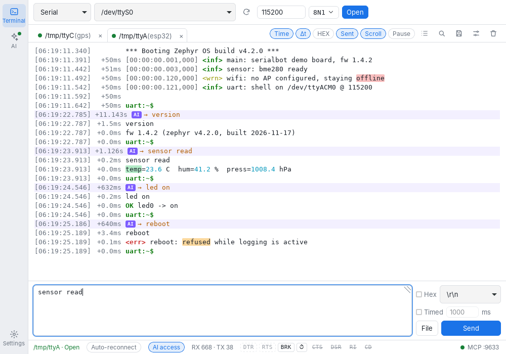
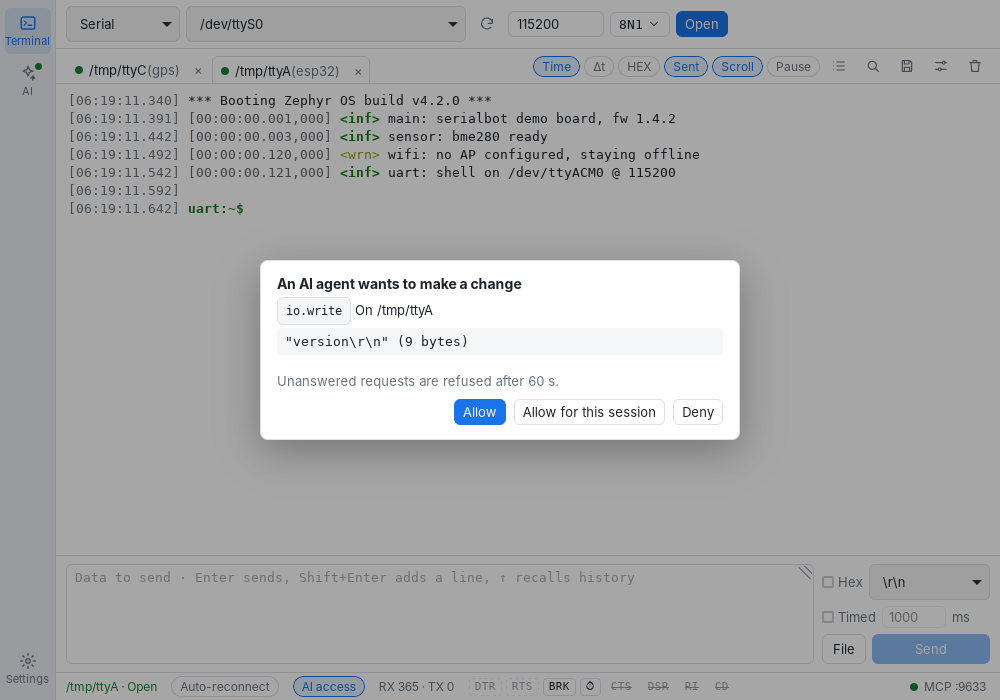
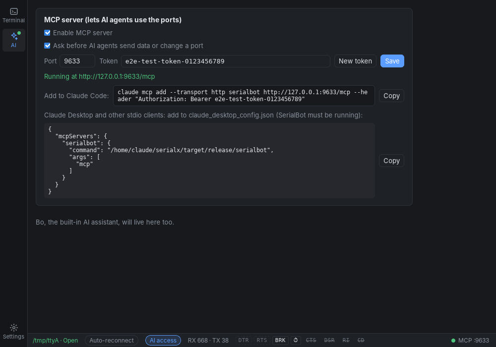
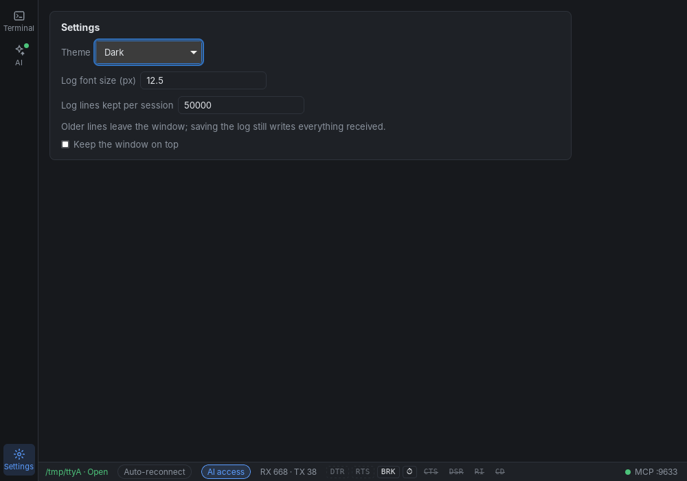

<div align="center">


# SerialBot

**轻量、跨平台的串口调试助手，内置 MCP 服务，让 AI 也能直接操作串口** 🔌🤖

[](https://github.com/jerry-token/serialbot/actions/workflows/ci.yml)
[](https://github.com/jerry-token/serialbot/releases)

[](LICENSE)

[English](README.md) · 简体中文


<sub>☝️ AI 通过 MCP 打开开发板串口并发送命令，你确认后执行，每一步都实时显示在窗口里，并带 AI 标记</sub>

</div>

> [!NOTE]
> 🚧 **当前是 Alpha 测试版**：日常调试和 AI 控制都已可用，欢迎试用并[反馈问题](https://github.com/jerry-token/serialbot/issues)。

## ✨ 特性

**轻量，哪里都能用**
- 🪶 Windows 安装版约 4.5 MB；免安装单文件版约 19 MB，不用安装直接运行。
- 💻 Windows、macOS（Apple Silicon 和 Intel）、Linux（x64 和 arm64，包括树莓派）。

**连接**
- 🗂️ 多个串口同时打开：每个一个标签页，各自有日志和收发计数。
- 🌐 除了串口，还支持 TCP 客户端、TCP 服务端和 UDP，在连接栏最左边选择类型。
- 🔁 拔掉串口再插上，会话自动接上；串口列表随插拔刷新。
- 🎛️ DTR / RTS 开关，CTS / DSR / RI / CD 指示灯，**BRK** 发送 BREAK，**⏱** 执行带时间的 DTR/RTS 时序（例如复位脉冲 `DTR=0 RTS=1, 100, RTS=0`），每次变化都记在日志里。

**接收**
- 🌈 文本 / HEX 显示，毫秒级时间戳；支持 **ANSI 颜色**（Zephyr、ESP-IDF 等彩色日志）和 UTF-8、GBK、GB18030、Big5、Shift_JIS 等编码。
- ✂️ 按间隔自动断帧；**Δt** 显示与上一行的时间差，HEX 视图下就是帧间隔。
- 🔎 `Ctrl/Cmd+F` 搜索、"只显示匹配的行"过滤，以及**关键字高亮**（在 ⚙️ 里填 `ERROR`、`WARN` 等）。
- ⏸️ 暂停；几万行日志滚动依然流畅。
- 💾 一次性保存日志，或边收边写入文件。

**发送**
- ✍️ 多行输入，文本或 HEX，可选结尾符；`Enter` 发送，`Shift+Enter` 换行，`↑` 调出历史。发出去的是原始字节，和输入完全一致，只加你选的结尾符。
- 🧮 HEX 发送可自动追加校验：CRC-8、CRC-16（Modbus、CCITT）、CRC-32、XOR、SUM8、LRC。
- ⏲️ 定时发送、📋 扩展命令列表（点一下发送，或整组按顺序执行）、📄 分块发送文件。

**AI 能用，你说了算**
- 🤖 内置 MCP 服务：Claude Code、Claude Desktop 等 AI 工具可以列出和打开串口、收发数据、等待回复、控制 DTR / RTS，用的就是你在窗口里看到的会话。
- ✅ AI 发送数据、切换信号线、打开/关闭/改配置串口之前，SerialBot 会先问你：**允许一次**、**本会话都允许**或**拒绝**（60 秒不处理自动拒绝）。
- 🟣 AI 做的每件事在日志里都带 **AI** 标记；在状态栏关掉 **允许 AI**，这个会话就不让 AI 碰。
- 🔒 MCP 服务默认关闭，只监听 `127.0.0.1`，需要令牌。

**用着顺手**
- 🌗 浅色 / 深色 / 跟随系统主题，日志字号，每个会话保留的行数，窗口置顶。
- 🌏 中文和英文界面。

## 📸 截图

| 深色主题 | 浅色主题 |
|:---:|:---:|
|  |  |

<details>
<summary>✅ AI 操作前的确认弹窗</summary>



</details>

<details>
<summary>🤖 AI 页：MCP 服务设置</summary>



</details>

<details>
<summary>⚙️ 设置页</summary>



</details>

## 📦 下载安装

到 [Releases 页面](https://github.com/jerry-token/serialbot/releases) 下载对应系统的文件：

| 系统 | 文件 | 说明 |
|---|---|---|
| 🪟 Windows 10/11 | `SerialBot_*_x64-setup.exe` | 安装版（约 4.5 MB，已压缩），不需要管理员权限 |
| 🪟 Windows 10/11 | `serialbot_windows_x64.exe` | 免安装版（约 19 MB，未压缩），双击直接运行 |
| 🍎 macOS 11+ | `SerialBot_*_universal.dmg` | Apple Silicon 和 Intel 通用（约 11 MB） |
| 🐧 Ubuntu / Debian | `SerialBot_*_amd64.deb` | 约 6 MB；`sudo apt install ./SerialBot_*.deb` |
| 🐧 Ubuntu / Debian arm64 | `SerialBot_*_arm64.deb` | 树莓派 4/5（64 位系统）等 ARM 设备；`sudo apt install ./SerialBot_*_arm64.deb` |
| 🐧 其他 Linux arm64 | `SerialBot_*_aarch64.AppImage` | `chmod +x` 后直接运行 |
| 🐧 其他 Linux | `SerialBot_*_amd64.AppImage` | 约 80 MB（自带运行库）；`chmod +x` 后直接运行 |

<details>
<summary>⚠️ 首次打开遇到提示？</summary>

- **macOS 提示「已损坏」或「无法打开」**：Alpha 版还没做苹果公证，在终端执行一次：
  ```sh
  xattr -dr com.apple.quarantine /Applications/SerialBot.app
  ```
- **Windows 提示「未知发布者」**：点「更多信息」→「仍要运行」。
- **Linux 打不开串口（权限不够）**：执行下面这条，然后重新登录：
  ```sh
  sudo usermod -aG dialout $USER
  ```

</details>

## 🚀 快速上手

1. 🔌 插上 USB 转串口模块，在顶部选择端口，设置波特率。数据位、校验、停止位、流控在 `8N1 ▾` 里，然后点 **打开**。
2. 📥 接收区默认显示时间戳。右上角的小开关可以切换 Δt、HEX 显示、显示发送内容、自动滚动、暂停；🔍 是搜索，⚙️ 里可以设置编码、自动断帧、ANSI 颜色和高亮关键字。
3. 📤 在底部输入框写好命令，按 `Enter` 发送。勾选 HEX 可以发送 `01 03 00 00` 这样的十六进制数据。
4. 🎛️ 需要复位开发板时，点状态栏的 **DTR / RTS**，或用 **⏱** 执行带时间的时序。

> [!TIP]
> 如果开发板没有接 CTS 线，流控请保持「无」。开着 RTS/CTS 硬件流控时，数据会因为 CTS 无效而发不出去。

## 🤖 让 AI 操作串口（MCP）

1. 点左侧 **AI** → 勾选 **启用 MCP 服务**。服务只监听本机 `127.0.0.1`，访问需要 token。
2. 点 **复制**，在终端里运行复制下来的命令，例如：
   ```sh
   claude mcp add --transport http serialbot http://127.0.0.1:9633/mcp \
     --header "Authorization: Bearer <你的 token>"
   ```
3. 在 Claude Code 里直接说：*「列出串口，打开 ESP32 那个口，发送 `version` 看看固件版本」* 🎉
4. ✅ AI 打开串口或发送数据前，SerialBot 会先弹窗问你。选 **本会话都允许** 后，这个串口就不再询问；也可以在 AI 页取消勾选「AI 发送数据或改动串口前先问我」。

**Claude Desktop**（以及其他只支持 stdio 的客户端）：把 AI 页上的第二段配置复制到 `claude_desktop_config.json`。它运行 `serialbot mcp`，一个连接到正在运行的 SerialBot 的小桥接程序，所以需要先打开 SerialBot 并启用 MCP 服务：

```json
{ "mcpServers": { "serialbot": { "command": "/Applications/SerialBot.app/Contents/MacOS/serialbot", "args": ["mcp"] } } }
```

Windows 上 command 填 `serialbot.exe` 的路径（安装版或免安装版都行）；Linux 上填 AppImage 的路径或 `/usr/bin/serialbot`。

| 工具 | 作用 |
|---|---|
| `port.list` / `session.list` | 列出串口 / 已打开的会话 |
| `session.open` | 打开串口（可以起个别名，比如 `esp32`） |
| `io.write` / `io.read` | 发送数据 / 按游标读取带时间戳的日志 |
| `io.wait_for` | 等待接收内容匹配某个正则表达式 |
| `io.send_and_expect` | 发送一条命令并等待期望的回复 |
| `io.signals` | 设置 DTR / RTS，读取 CTS / DSR / RI / CD |
| `session.close` | 关闭会话的端口，日志仍可读取 |
| `session.release` / `session.reopen` | 把端口让给其他工具（如烧录器）再取回，日志接着记 |
| `session.configure` | 不断开修改波特率 |
| `log.mark` / `log.query` | 插入命名标记；汇总或搜索标记之后的日志 |
| `command.list` / `command.call` | 其余命令：改别名、自动重连、发送 BREAK |

## 🗺️ 路线图

- [x] 串口、TCP、UDP；多会话；文本 / HEX、ANSI 颜色、多编码、自动断帧
- [x] 发送：历史、定时发送、扩展命令列表、发送文件、校验和
- [x] 信号线：DTR / RTS、状态灯、BREAK、时序
- [x] 日志：搜索、过滤、Δt、关键字高亮、保存与边收边存
- [x] 内置 MCP 服务（HTTP 和 stdio）、操作确认、按会话控制 AI 权限
- [x] Windows、macOS、Linux（x64 / arm64）安装包自动发布
- [ ] TCP 服务端多客户端、命令列表独立窗口
- [ ] 终端模式（VT100、交互式 shell）和波形图
- [ ] 内置 AI 助手「小波」
- [ ] JS 脚本
- [ ] BLE

## 🛠️ 从源码构建

需要 Rust（版本由 `rust-toolchain.toml` 自动安装）和 Node 22+。Linux 还要装几个系统库：

```sh
sudo apt install libwebkit2gtk-4.1-dev librsvg2-dev libayatana-appindicator3-dev libudev-dev
```

```sh
cd app && npm ci && npm run tauri dev     # 运行桌面版
cargo test --workspace                    # Rust 测试
cd app && npm test                        # 前端测试
cargo run -p serialbot-mcp                  # 不带界面，单独运行 MCP 服务
```

每次改动都要附带测试，并通过格式、clippy、测试和覆盖率检查，详见 [CLAUDE.md](CLAUDE.md)。

## 🤝 反馈

发现 bug 或有功能建议，欢迎提 [Issue](https://github.com/jerry-token/serialbot/issues)。请附上：

- 📷 截图
- 💻 操作系统
- 🔌 串口芯片型号（CH340 / CP2102 / FT232 / CH9344 …）

## 📄 许可证

核心代码使用 [GPL-3.0-only](LICENSE)。插件 SDK 和设备端库将使用 MIT 许可。
